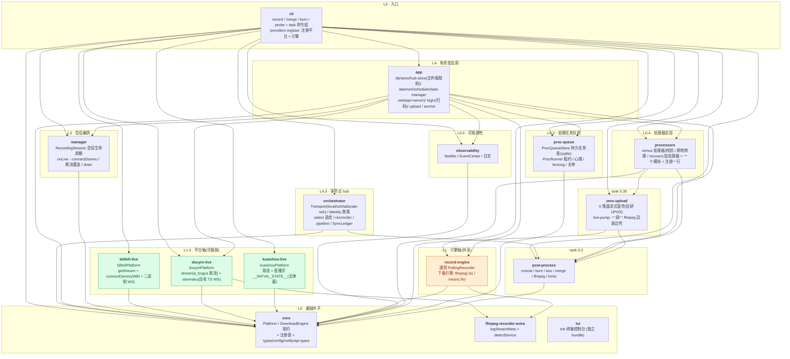
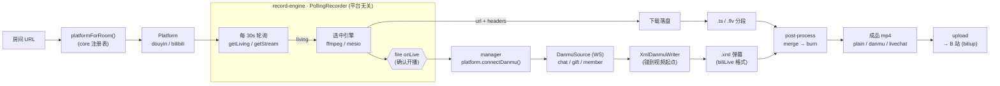
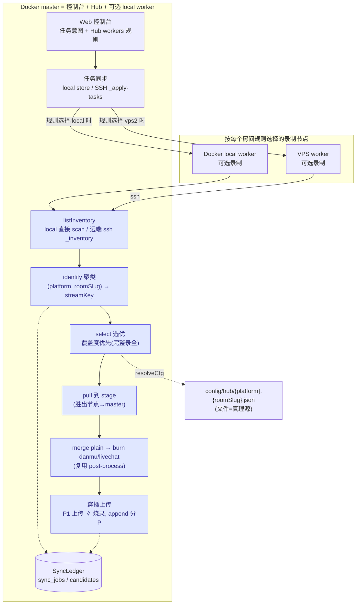

# 架构

pnpm workspace monorepo，13 个包，收敛成 **2 个可插拔接缝** + **1 个多节点编排层**：

- **平台轴**（`<平台>-live`）—— 平台专属的一切：取流（`getStream`）+ 弹幕（`connectDanmu`）+ 开播判定（`getLiving`）。接新平台 = 写一个 `<平台>-live` 实现 `Platform` 接口 + `registerPlatform` 一行。
- **引擎轴**（`record-engine`）—— 平台无关的下载：通用 `PollingRecorder` + 下载引擎策略（`ffmpeg` / `mesio`）。加新引擎 = 写一个 `DownloadEngine` 策略 + `registerEngine` 一行，所有平台立即可用。
- **多节点 hub**（`orchestrator`）—— Docker `task serve --hub` 同时提供控制台、master 编排和 `local` 录制 worker；录制落在哪个节点由每个房间的 Hub 规则选择。规则绑定 master 上的源任务（`recording.sourceTaskId`）并将启用状态同步给选中的 worker；选 VPS 且不选 `local` 时，master 仍保存任务配置与启停意图，但抑制该房间的本机录制。选中多个 worker 会产生多份录制副本。master 读取节点清单、按 `(platform, roomSlug)` 聚类、覆盖度选优、拉取胜出文件到本机，再执行合并/烧录/上传。VPS worker 运行普通 `task serve`，不运行 Hub。任务与 Hub 配置通过 Web 控制台维护。详见 [multi-node-sync.md](./multi-node-sync.md)。

依赖**只能向下**（`test/arch/layering.test.ts` 守护：每个包的 rank 必须严格大于它依赖的任何包；新增包须在 `RANKS` 登记）。esbuild 把 `cli` 打成自包含单文件 `dist/douyin-rec.mjs`（+ 独立的 `dist/tui.mjs`）。

> **热图(自动生成)**:[architecture.html](./architecture.html) —— 包热图(语义角色 + 变更热度)、运行流程图、依赖边。
> 它由 `scripts/gen-architecture.mjs` 从仓库真实数据(包依赖 / LOC / git 变更 / 分层表)生成,**不要手改**
> (会被下次生成覆盖)。改了架构后跑 `pnpm arch:gen` 重新生成;`pnpm arch:check` 校验是否与仓库一致。
> 本文(`architecture.md`)是**叙述性真相源**,`architecture.html` 是其可视化快照。CLI / app 层细节见 [cli.md](./cli.md) · [app.md](./app.md)。

> **现状 vs 目标**:本文件上文（依赖图 / 生成段落 / 数据流）描述**当前已实现**的架构；
> 末节 [目标架构：030 计划带来的改进](#目标架构030-计划带来的改进计划中未落地) 描述**计划中**的
> 实时状态、非阻塞派发、共享上传冷却、控制面安全阀、统一房间入口等改造（`T-30`，**尚未落地**）。
> `architecture.html` 里对应两个标注「计划中」的流程与一张「030 计划改进」表，与本末节同步。

## 依赖分层图

箭头 = 「依赖」（A → B 表示 A 用 B）。层级越低越通用，只能被上层依赖。**绿色 = 平台轴**接缝、**橙色 = 引擎轴**接缝。

<!-- BEGIN GENERATED: deps -->



<!-- END GENERATED: deps -->

> **`app` 与 `orchestrator` 是平级 peer(不是栈)**:`orchestrator` 的真实依赖只有 `core` + `post-process`,
> **不依赖 `app`**(反之亦然)。两者由 `cli`(组合根)用 `hubStarter` 回调缝在一起 —— app 定义
> `HubStarter` 接口,cli 提供 orchestrator 的实现并注入。故上图无 `orch → app` 边;rank 4.5 只表示
> 「比 app 更靠上」,不代表依赖它。这条关系**无法从 package.json 看出**,只能从注入点得知。

> `web/`（React19 + jotai + @base-ui/react + Tailwind v4）是**独立 Vite 工程**，构建产物 `packages/web/dist` 由 `app` 的 web server 托管，不参与上面的 `@drec/*` 依赖图。

## 运行时数据流（一次录制会话）

`app` 的 daemon 在定时窗口内 spawn 一个 `record` 子进程；`record-engine` 的 `PollingRecorder` 经注册表 `platformForRoom(url)` 拿到平台实例驱动取流，确认开播那一刻 fire `onLive`，`manager` 据此扇出弹幕。视频与弹幕分别落盘，事后由 `post-process` 合并/烧录、`upload` 投稿。



**两个接缝在数据流里的体现：**

- **平台轴**只回答「这个房间在播吗 / 流地址是什么 / 弹幕从哪连」——`getLiving` / `getStream` / `connectDanmu`。换平台不动录制逻辑。
- **引擎轴**只负责「把 `getStream` 给的 `url + headers` 下载到磁盘」——`ffmpeg`（`-c copy` → `.ts`）或 `mesio`（rust-srec `--fix` → `.flv`），并透传平台给的 headers（如 bilibili CDN 的 Referer/UA）。换引擎所有平台立即生效。

## 多节点 hub 数据流（节点录制 → master 后处理）

**角色由运行进程决定，不代表机器只能承担一种角色。** Docker 运行 `task serve --hub`，既是 master 控制器，也是 `local` worker；它可以录制分配给本机的房间。VPS 运行普通 `task serve`，作为远端 worker，由 master 同步任务并读取录制清单。每个房间的 Hub 规则 `workers` 决定实际录制节点：

- `["local"]`：仅 Docker 本机录制。
- `["vps2"]`：仅 VPS 录制；master 上的源任务是控制台中的配置与启停意图，本地 daemon 不会启动该房间的录制进程。
- `["local", "vps2"]`：两个节点都会录制，形成冗余副本，收播后由 master 选优。

启用源任务代表“该房间需要录制”，不单独指定本地录制。通过控制台启动或停用源任务，Hub 会把 enabled 状态同步给规则选中的 worker。Hub 页负责绑定源任务和选择节点；任务页负责房间任务及启停。远端受管任务标记为 `managedBy='hub'`，只能在 master 控制台操作。

实际流程是：master 下发任务期望 → 被选 worker 各自录制 → master 扫描节点清单并等待录制结束 → 按覆盖度选优 → 从胜出节点拉取到 master 的 `stage/` → 合并/烧录/上传。master 是后处理和上传的控制点；VPS 不运行 Hub，也不负责这条后处理管线。master 任务页同时显示所选 worker 的实时录制状态，约每 5 秒刷新一次；不会把本机任务进程状态误当成远端状态。



- **触发**：master 本机录制产生的 `recordEnd` 可即时触发；远端收播事件不会作为本地 `recordEnd` 直接转发，远端录制场景由周期 `reconcileAll` 扫描发现。pipeline 会等待 settle，并跳过仍在录制的场。
- **选优**：完整录全（单会话无断流）优先；**所有节点都断流 → 中断 + 通知 + 不删源**。
- **配置与操作**：每房间一份 `config/hub/{platform}.{roomSlug}.json`（`upload.mode`=stage|upload + `private`），由 Web 控制台 Hub 页维护；录制任务在任务页管理。规则文件是配置真源，API 现读，控制台变更会反映到同步与调度。
- **录制范围**：只有规则选中的节点会参与该房间录制与选优；Docker 运行 Hub 不会默认使它再录一份。选择 `local` 与远端 worker 才是显式双录。关水印/仅自己可见/copyright 是 `biliup.ts` 代码常量（不可配）。

## 目标架构：030 计划带来的改进（**计划中，未落地**）

> 来源：`plans/030_hub_tasks_optimization.md`（结构化任务 `plans/030_tasks.json`，台账 `T-30`）。
> 本节**手写**，用来叙述「改造后架构长什么样、为什么这么改」。上方的依赖图与 `architecture.html` 是
> 从仓库**现算**的生成物（`pnpm arch:gen` 会覆盖），二者职责不同：生成物描述**现状**，本节描述**方向**。

### 1. 状态从「轮询」改为「推送」（实时性）

```
现状： QueuePage 3s / HubPage 3s(5s) / RoomDetail 3s(5s)  各自 setInterval 拉整份数据
         └─ 无重入保护（慢请求会用旧响应覆盖新状态）、错误静默、时长靠重拉刷新

目标： 写入方(任务/录制状态 · sync 台账 · 资源池)  ─┐
                                                    ├─→ HubWatch(指纹: MAX(updatedAt)/rowid,1s 轮询 + 去抖)
        GET /api/hub/stream (SSE: changed 帧 + 心跳) ─┘         │
                                                    ├─→ QueuePage（本地 1s 计时）
                                                    ├─→ HubWorkflow（PipelineFlow）
                                                    └─→ RoomsPage
        EventSource 断开 → 指数退避兜底轮询(3s→30s,隐藏页暂停);页面显示「数据可能已过期」
```

- **为什么**：状态与计时天然一跳一跳；SSE 让两处 UI 在同一时刻看到同一真相。
- **单页只 1 条 SSE**（模块级单例 + 引用计数），避免多组件各建连接。
- 只读连接加 `PRAGMA busy_timeout`，避免 SQLITE_BUSY 时队列页静默变空。

### 2. 编排：跨房间不再互相阻塞（吞吐/公平）

```
现状： reconcileAll()  for (broadcast) → await _runPipeline(...)     ← 单场长上传挡住后面所有房间建 job
         （ResourcePool 只能让已进入的 pipeline 互相排队,消除不了这个串行）

目标： reconcileAll()  ┌ 阶段①(快)：过滤 + upsertPending 建全部 job
                      └ 阶段②(慢)：JobDispatcher(有界并发,缺省 2)
                                      └ withStreamLock(同 streamKey 串行) → pipeline → ResourcePool(cpu/net/upload)
        仍 await dispatcher.drain() —— 保留 hub 的 running 守卫,防重复建稿
```

- **收益**：后一房间的 job 行立即可见；下个房间的 pull/net/upload 能与前一房间的 CPU 编码重叠。
- **边界**：`maxCpuParallel` 仍缺省 1 → merge/burn 依旧串行；上传队列按设计全局串行（防 601）。要真并行需 D4 提高内存配额。

### 3. 上传限流：从进程内存变为**跨重启持久 + 主/节点共用**

```
现状： ResourcePool.uploadBlockedUntil / uploadTimes 只在内存 → master 重启即丢(可能立刻再打爆 B 站)
       节点侧上传(app/node-pipeline)完全绕过 ResourcePool → 无冷却、无窗口

目标： core/upload-gate.ts(共享,按账号键 'bilibili:<mid>')
        ├─ orchestrator ResourcePool 复用其语义(冷却/窗口)
        ├─ app/node-pipeline 上传前 awaitSlot()(节点本地 DB 行)
        └─ 冷却截止/窗口持久化 → 重启后仍生效
```

- **分层要点**：共享件放 `@drec/core`（rank 0），**不能让 app(L4) import orchestrator(L4.5)**（`test/arch/layering.test.ts` 守护）。

### 4. 控制面：误删防护 + 禁用≠删除

```
现状： master 读不到 config/hub/ → listHubRules=[] → desired=[] → 「缺席即两阶段删除」→ 节点任务被清空(实测)

目标： ① 审计快照 managed/rooms.json(仅可观测/版本回执,**不作删除依据** —— 快照≡期望,diff 恒空)
       ② 骤减守卫：空期望且本地有受管任务 → 拒绝(rejected);期望 ≤ floor(受管/2) → 只停不删
          · 空期望守卫用 totalManaged(含 disabled);比例守卫用 enabledManaged
          · 显式强通道 force(DREC_ALLOW_SHRINK / POST /api/hub/apply?force=1)承接合法缩容(T-17 场景)
       ③ 语义分离：规则 disabled → 节点 enabled:false(停用保留);规则文件消失 → 两阶段删除
```

### 5. 入口收敛：先「一处配完」，不急着合页（低风险优先）

```
现状： 任务页配「录制」(tasks 表) + Hub 页配「处理/节点」(config/hub/*.json)，靠 sourceTaskId 绑；两处保存易半成功

目标(低风险版 M3)：在**既有 Hub 页**就地收敛，不新建页、不退役旧入口
        HubRuleDialog 增「录制」区块  ── PUT /api/rooms/:key ──→ 后端单事务写两半(失败回滚)
        RoomDetail 增房间级动作：启停自动录制 / 结束后停止(drain) / 立即停止(硬停,二次确认)
                                / 立即处理本场 / 重试清理
        既有 Tasks 页与 Hub 配置页 **行为零变更**（随时可回退）

延后(需你确认后立项, T20)：完整单页 RoomsPage + 退役旧入口 —— 这是**需求反转**而非修 bug，
        合并后是否更好无法从代码证明；先用低风险版验证「一处配完是否够用」。
```

### 6. 产物完整性 + 录制健康

```
产物： 上传后按「实际上传的批次数」核验 countVideoParts(bv) —— 分段路径与合并路径都写 sync_parts 基线
        biliup 返回 0 即成功 → 无条件清理;延迟 10 分钟旁路回读分 P 数(只记录/告警,不影响清理)
        清理失败不再吞错 → clean_* = failed(可见、可重试);job 终态仍为 done

录制： 只有「录制时长 ≥ 120s 且进度新鲜」才清零重连退避(现状 onLive 无条件清零 → 1650 次 5s 风暴)
        连续短命 → 递进退避 + 熔断告警(不放弃,持续按封顶重试)
```

### 7. 版本可见性（多节点分发）

```
节点 managed/rooms.json 增 {version, appVersion, appliedAt} → `_node-status` 读回
master /api/hub/workers/status 透出 appliedVersion / expectedVersion / bundleVersion / syncError
UI 节点列表显示版本列 + 漂移告警(旧 bundle 兼容:显示 unknown 而非报错)
```

### 落地顺序：四个里程碑，分批发版

| 里程碑 | 名称 | 任务 | 发布门槛 |
|---|---|---|---|
| **M1** | P0 止血（首要） | T1 T2 T3 T11 T12 T13 T14 | 节点任务不再被误删；分P 不符不删源；清理失败可见可重试；短命录制退避递增 |
| **M2** | 实时与吞吐 | T4 T5 T6 T7 T8 T15 T19 | SSE 1s 内同步且无旧值覆盖；后一房间 job 行立即可见；冷却跨重启保留；节点侧共用冷却 |
| **M3** | 房间入口（低风险版） | T9 T10 T18 | 既有 Hub 页一处配完房间 + 房间级动作；既有页面行为零变更 |
| **M4** | 可选 / 需确认 | T16 T20 | T16 运维可见性按需；T20 是需求反转，**需你确认后立项** |

每个任务 = 一份 PR 级改动（含 files/subtasks/tests/acceptance），完成即跑验证门
（`pnpm test` / `typecheck` / `bundle`；动前端加 `packages/web` build；动架构跑 `pnpm arch:gen`）。

**里程碑与状态由 `plans/030_tasks.json` 直接驱动**（`gen-architecture.mjs` 读取渲染）→ 计划改了，图跟着变，不会漂移。
